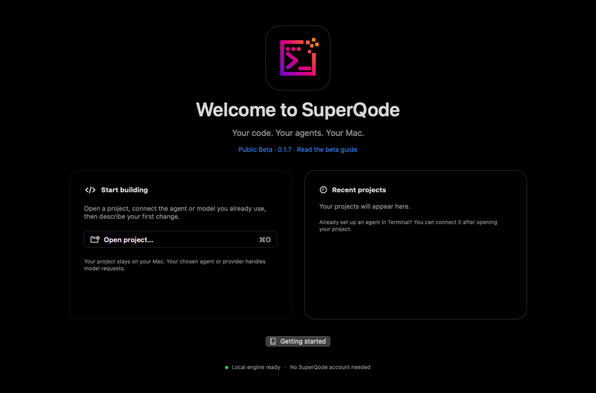

# SuperQode for macOS

Your code. Your agents. Your Mac. A native workspace for coding, reviewing changes, exploring Harness Hub, evaluating results and improving harnesses.

Source version: **0.1.10 (build 11)**, with bundled engine **2.25.0**.
The public download remains 0.1.9 until a signed and notarized 0.1.10 is published.

[**Download public beta 0.1.9**](https://superqode.dev/downloads/macos/0.1.9/SuperQode-0.1.9-arm64.dmg)

**Apple Silicon · macOS 14 or later · Signed and notarized · Python engine included**

<picture>
  <source media="(prefers-color-scheme: light)" srcset="../../assets/superqode-macos-welcome-light.png">
  
</picture>

## Start coding

1. Open the DMG, drag SuperQode to Applications and launch it from Applications.
2. Choose **Open project** and select a repository you can safely work in.
3. Choose **Connect** and select an agent or model you already use.
4. Describe a small task, press **Enter** to send (**Shift-Enter** adds a line), review permissions and inspect the changes.

No SuperQode account, App Store installation or separate Python installation is required. External coding agents and local model servers may need their own setup. Their authentication, privacy terms, subscriptions and usage charges apply.

The welcome page and **Help → Getting Started & Learning** guide you through coding, review and more advanced capabilities. The Home button returns to Welcome without closing your project or discarding drafts.

## Choose your connection

- **Existing harness or subscription:** connect supported agents using their own accounts and model choices.
- **Harness with your model:** choose a harness, then connect a provider key or supported local model. Detected Ollama models can be selected directly.
- **Protocols:** connect through ACP, A2A or UHP where the selected agent or server supports the required operations.
- **Build your own:** start from a preset, use the guided builder, or import and edit a HarnessSpec.

Connection options depend on the runtime. Supported ACP agents expose model, mode, configuration and slash-command controls when advertised. Resume and remote cancellation also depend on the selected runtime. Existing terminal credentials remain supported, and optional app-managed provider keys can be saved in macOS Keychain.

You can change agents within the same conversation. SuperQode keeps the local transcript and sends bounded conversation context to the selected agent. Returning to an agent resumes its compatible session when available. Agent permissions and authentication remain separate; historical images may need reattaching, and long handoffs may omit messages from agent context while retaining them in your local history.

Selecting a connection does not automatically install an agent, download weights or start a paid model call. Model tests, evaluation and optimization can incur provider charges; review their prompts and budgets before starting.

## Your daily workspace

- **Agent Space:** stream responses, inspect tool activity, approve or deny actions, continue supported sessions and use direct Chat mode.
- **Files:** browse and edit source, create files, inspect diffs, stage or unstage changes and create local commits after confirmation.
- **Context:** attach project text or images, preview selected context and manage supported context-window and compaction controls.
- **Tasks:** prepare independent tasks, reorder the queue and explicitly start work. Failed tasks pause the queue; interrupted work is not automatically replayed.
- **Checkpoints:** inspect recorded changes and use guarded restoration, undo and redo.
- **Terminal:** run interactive project commands in the integrated native terminal.

Navigation starts with Agent Space, Files and Terminal. **Improve & more** reveals additional tools as you need them. Native menus and keyboard shortcuts remain available.

In the development source, **Command-K** opens the command palette. Search actions,
the twelve most recent runs in the current project, or eight recent projects.
Use Up/Down and Return to choose, or Escape to close and return to the previous
control. Unavailable actions show what they need. Menu actions and palette actions
share their shortcuts and availability rules. This feature still requires native
build and interaction validation before inclusion in a public release.

## Harness Hub, evaluation and optimization

**Harness Hub** lets you explore shared harness definitions and choose a setup for coding, evaluation or optimization. Your project can keep its own inspectable HarnessSpec.

**Evaluations** compares baselines and candidates, including per-task outcomes, costs and regressions. Review setup before authorizing live execution.

The development source adds a task comparison inspector for evaluation and
optimizer held-out results. Choose a candidate, search task IDs, filter
regressions/improvements/incomplete evidence, and inspect reasons and reported
cost/time changes. Unknown usage remains unknown; smoke-only checks do not count
as task-quality improvements. This is a review aid, with native validation still
pending. See the [feature checklist](FEATURE-PARITY.md) for remaining native gaps.

**Optimization** supports bounded Omni experiments, candidate diffs and reviewed adoption of a validated harness revision.

**Tools** provides typed command forms for additional workflows, including WorkOrders, skills, memory, MCP, refinement, promotion, local engines, model downloads and other optimizers. Some advanced capabilities use these forms rather than dedicated graphical dashboards.

## Appearance and accessibility

Choose dark, light or system appearance in Settings. SuperQode's purple, pink and orange branding adapts for readable text. Gradient responses are optional; source code and diffs keep plain text colors. Animations respect Reduce Motion, materials respect Reduce Transparency and Increased Contrast uses system text colors.

## Data and permissions

Projects and history remain on your Mac. Requests and explicitly attached context go directly to your selected provider or remote agent. There is no SuperQode cloud-history account. Local application data is stored under `~/Library/Application Support/SuperQode`.

Agents and terminal commands run with your Mac user's access; the app is not an operating-system sandbox. Use trusted agents and a backed-up repository, review commands and inspect changes. History and evidence exports may contain private project content, so review them before sharing.

## Beta notes and feedback

Some integrations and advanced workflows are experimental, and full terminal feature parity is not included. This build supports Apple Silicon; Intel Macs and remote access to your Mac are not included. Updates are manual: quit SuperQode and replace it with a newer download.

Read the [beta notes](BETA-NOTES.md), [verify the checksum](https://superqode.dev/downloads/macos/0.1.9/SuperQode-0.1.9-arm64.dmg.sha256), or [report an issue](https://github.com/SuperagenticAI/superqode/issues). Include app, macOS and agent versions and remove credentials and private project content from reports.

## Build from source

See the [native developer experience review and build plan](DEVELOPER-EXPERIENCE.md)
for source comparisons, implemented history improvements and the proposed next steps.

For future Mac App Store work, see the separate
[App Store preparation guide](../../proc/MACOS-APP-STORE.md). The current public beta
uses website distribution.

Requires Xcode with the macOS SDK, Apple Silicon and macOS 14 or later. The minimum OS is the build target; clean-machine compatibility still needs release validation.

Create the isolated engine environment and payload from the repository root:

```sh
UV_PROJECT_ENVIRONMENT=apps/macos/.build-venv uv sync --frozen --no-dev --no-editable --python 3.13
python3 apps/macos/scripts/bundle-runtime.py
python3 apps/macos/scripts/make-icon.py
apps/macos/scripts/build-app.sh
open apps/macos/release/SuperQode.app
# Optional local installers:
apps/macos/scripts/package-distribution.sh
```

SwiftPM pins SwiftTerm for the AppKit project terminal; its license is bundled with the app. The runtime builder pins the compatible Omni optimizer revision and records dependencies and source provenance. Model weights, user configuration and credentials are excluded from the bundle. Python is an execution dependency; all desktop presentation, navigation, lifecycle, dialogs and integration are Swift.

For development, `swift build --package-path apps/macos` builds the executable. The packaging script selects full Xcode when available and places compiler caches inside `.build`. `CONFIGURATION=debug apps/macos/scripts/build-app.sh` packages a debug build. Open `Package.swift` in Xcode to work on the native sources.

### Upload a notarized website release

Store GoDaddy settings in `~/.env.macos-release`, outside the repository:

```dotenv
FTP_HOST=your-certificate-compatible-server-hostname
FTP_USER=your-ftp-user
FTP_PASSWORD=your-ftp-password
FTP_REMOTE_DIR=/downloads/macos
```

Use the FTP account's directory root: `/downloads/macos` applies when the account
opens inside `superqode.dev`. Values are read literally, without shell expansion;
matching outer single or double quotes are optional. Restrict file access and
check the connection without changing server files:

```sh
chmod 600 ~/.env.macos-release
python3 apps/macos/scripts/upload-release.py
```

The uploader uses explicit FTPS on port 21 (optional `FTP_PORT` override), with
certificate validation and encrypted data transfers. Use the server hostname
covered by GoDaddy's certificate rather than its IP address. It requires the
existing `latest/SuperQode-arm64.dmg` and checksum to confirm the destination.

After signing, notarizing and stapling the DMG, publish it with:

```sh
python3 apps/macos/scripts/upload-release.py --upload
```

No version argument is needed: the script reads the current version from
`apps/macos/resources/Info.plist` and selects its matching DMG in `release/`.
It rejects packaged app metadata that differs from the source, rather than
guessing from file timestamps. An explicit DMG path after `--upload` remains
supported when needed.

Exported `FTP_HOST`, `FTP_USER`, `FTP_PASSWORD`, `FTP_REMOTE_DIR` and optional
`FTP_PORT` environment variables override file values. If all required variables
are set, no file is needed. `--config /path/to/private-file` or
`SUPERQODE_MACOS_RELEASE_CONFIG` selects a different configuration file. Nothing
loads a credentials file from the repository automatically.

This command checks signing, the stapled ticket and Gatekeeper acceptance. It
uploads the versioned archive, then replaces `latest/SuperQode-arm64.dmg` and its
checksum. Each pair is transferred to temporary names and its remote bytes are
verified before renaming. The two renames are separate FTP operations; run only
one uploader at a time. Existing versioned files must match exactly. Both public
DMGs and checksums are downloaded over HTTPS for final verification. The script
does not build, notarize, tag Python releases or edit the website.
