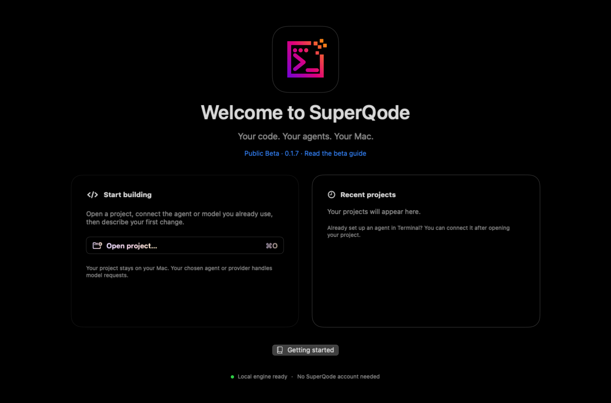

# SuperQode for macOS

The harness layer for coding agents. A native workspace for coding, reviewing changes, exploring Harness Hub, evaluating results and improving harnesses.

Normal launch stays on Welcome until you open a folder or choose a recent project.
Launch and project opening do not inventory model caches or probe a remembered
connection. Discover models explicitly in Local AI or connection setup. New
threads start disconnected; choose an agent or local model before sending.
Opening an existing thread restores its recorded connection where supported.
Live agent activity shows the current command or file target across supported
runtime event shapes.

[**Download the latest public beta**](https://superqode.dev/downloads/macos/latest/SuperQode-arm64.dmg)

**Apple Silicon · macOS 14 or later · Signed and notarized · Python engine included**

<picture>
  <source media="(prefers-color-scheme: light)" srcset="../../assets/superqode-macos-welcome-light.png">
  
</picture>

## Start coding

1. Open the DMG, drag SuperQode to Applications and launch it from Applications.
2. Choose **Open project** and select a repository you can safely work in.
3. Choose **Connect** and select an agent or model you already use.
4. Describe a small task, press **Enter** to send (**Shift-Enter** adds a line), review permissions and inspect the changes.

No SuperQode account, App Store installation or separate Python installation is required. External coding agents and local model servers may need their own setup. Their authentication, privacy terms, subscriptions and usage charges apply.

The welcome page and **Help → Getting Started & Learning** guide you through coding, review and more advanced capabilities. The Home button returns to Welcome without closing your project or discarding drafts.

## Composer controls and isolated drafts

For a harness that enforces SuperQode controls, choose **Code**, **Plan** or
**Chat** beside the composer. Plan inspects without writes, shell or network;
Chat answers without tools. In Code, **Ask** prompts for changes, **Auto-edit**
permits edits while keeping shell approval, and **Full** permits writes and shell
within the harness's existing limits. Network still asks when the harness allows
it. These are tool policies, not an OS sandbox. Unsupported agent/backend controls
are hidden and rejected by the engine. The next new conversation returns to Ask
after a Full task starts.

Use `@` to attach an available project file, paste an image, or drop supported
files into the composer. **Tasks → Isolate draft in a worktree** creates a branch
from the current commit and moves your unsent prompt, images and available file
attachments there. Uncommitted files remain in the source checkout; attachments
missing from the worktree stay with its source draft. Review before pressing Send.

**Super Agent** is a preview for drafting a harness and repository navigation
layout. Review the proposal, save a revision with a reason, then explicitly enable
it if a provider and model are bound. Generated harnesses use builtin tools with
recursion off. The optional Monty check only prints a next-prompt template; it does
not launch agents or install a plugin. Monty is not bundled in this macOS release.

## Start with a local model

Choose **Local model** from the connection grid, or open **Local AI**. The
newcomer screen focuses on Ollama and LM Studio. It shows your Mac's chip,
memory and macOS, detects installed engines and presents model suggestions
with approximate working-set ratings. Fits includes weights, context/KV cache,
buffers and headroom against an estimated Metal budget, not just file size.

If neither engine is installed, review and explicitly approve LM Studio's
official headless installer, or use **Get Ollama** and re-detect after installing.
Homebrew remains an option when present. Nothing installs or downloads just
because you open the screen. Review each start, download and load step. Model
download progress is shown in-app. LM Studio owns its transfers, so cancelling
the observer does not cancel its download manager.

Open a project to finish the context/tool readiness check on generated data.
Requested context and reported loaded context are distinct. One contract limits
context, output and KV cache; long requests include tool schemas in estimates,
trim complete older turns when possible and otherwise ask you to shorten the
prompt or start a new thread. These are conservative estimates, not exact
model tokenization. **Start coding** chooses Core and the checked model without
sending a coding prompt.

**Unload** frees model memory without deleting downloaded weights. **Stop**
stops an app-started server; LM Studio may retain loaded models in its daemon,
so unload them too. Existing servers are adopted without changing their settings.
The amber notice and **Learn more** cover memory, heat, battery and responsible
use. Models run on this Mac, but tools and configured services may use the network.
Other runtimes, the library, storage and compatibility controls stay under
**Advanced**. See the 0.4.0 release smoke checklist in [BETA-NOTES.md](BETA-NOTES.md). The 0.3.9 checklist remains below it.

Recommended search includes Hugging Face families. Select an exact GGUF or MLX
conversion to review its immutable revision, files and download size. Original
FP8/BF16 weights are not presented as ready-to-run GGUFs. DS4 recommendations open
the existing reviewed setup flow for your own executable and weights.

Provider setup highlights Chinese providers and aggregators with official docs,
key variable names and default endpoints. **Qwen China API** and **Qwen International
API** keep separate credentials. These are metered API routes; Coding Plan and
Token Plan keys belong in Qwen Code's interactive `/auth` flow.

## Your first harness check · no API key needed

1. Open a project and choose **Evaluations** under **Improve & more**.
2. Choose a built-in harness and a bundled suite such as **decision-routing**.
3. Leave **Live evaluation** off and choose **Check setup**. This validates the
   configuration without model calls. The tasks are skipped; it is not a quality score.
4. Open **Optimization → More harness workflows → Tune routing decisions from
   examples** and choose **Try practice examples · no calls**. Label the synthetic
   examples and reopen the saved round to learn the workflow. Practice cannot run
   live optimization or authorize adoption.
5. For real measurements, prepare your own graded tasks/examples, configure the
   required local model or provider keys, and explicitly authorize live execution.
   Review budgets, missing evidence and regressions before saving a candidate.

**Help → Getting Started & Learning → Harnesses** offers the same path inside the
app. Preparing an experiment or opening a screen does not start a live run.

## Choose your connection

**Harness Studio** is a primary sidebar destination for editing/importing a
HarnessSpec, validating without model calls, saving immutable revisions and
reviewing repeated read/edit checks. Choose a local model or provider route,
then select a saved revision for Agent Space. Unsaved Studio drafts last for the
current app session; saved revisions persist. Repeated checks use a restricted
read/edit profile, excluding source hooks, MCP, delegates, fallbacks and shell
execution. These checks do not certify the complete harness.

**Harness Hub** is available directly in the sidebar. Its **Build a harness**,
**Agent runtimes** and **ACP agents** actions also appear in Command-K.
Agent runtimes lists all 28 registered runtime/backend IDs, with setup status
and the supported selection path for each. See the
[complete runtime inventory](../../docs/integrations/runtimes-harnesses.md).

ACP agents now appear in a searchable icon grid with launcher/verification
filters. Open a card for guided setup, or explore the separate clients/ecosystem
directory. Threads show the distinct harnesses used, including multiple icons
after switching agents.

**Agent activity** brings app-owned threads across projects into one priority
view, with opt-in native alerts. Fork a finished thread into a new Git worktree,
review its context draft and integrate clean committed changes explicitly.

**All work** now combines the app-owned activity surface with an **External history**
tab. Connect a Codex session folder explicitly, browse/search its metadata and
review a text handoff into a new or idle thread's draft. Source files remain
unchanged; recorded external history does not imply live status or native resume.

- **Existing harness or subscription:** connect supported agents using their own accounts and model choices.
- **Harness with your model:** choose a harness, then connect a provider key or supported local model. Detected Ollama models can be selected directly.
- **Protocols:** connect through ACP, A2A or UHP where the selected agent or server supports the required operations.
- **Build your own:** start from a preset, use the guided builder, or import and edit a HarnessSpec.

Connection options depend on the runtime. Supported ACP agents expose model, mode, configuration and slash-command controls when advertised. Resume and remote cancellation also depend on the selected runtime. Existing terminal credentials remain supported, and optional app-managed provider keys can be saved in macOS Keychain.

Choose **Agent controls** beside the composer for CLI settings and commands.
Codex CLI exposes account models, reasoning effort, native Plan mode, sandbox
and approval settings. Antigravity CLI loads `agy models` and supports model,
agent and reasoning effort overrides (effort requires agy 1.1.5 or newer).
Grok CLI loads its subscription model catalog; Grok Build and other ACP agents
use the models, configuration choices and slash commands advertised by their
session. Copilot uses its account catalog, including plans where Copilot chooses
the model. Refreshing these catalogs does not send a coding prompt.

The panel also reads Codex inventories (sessions, usage, skills, plugins, apps,
hooks, features, permissions, MCP and redacted configuration) and Antigravity
agents, plugins, release notes and help. Detailed structured results are collapsed
by default. For interactive or terminal-only subcommands, **Open full CLI** starts
the installed vendor CLI in an embedded terminal after confirmation. This is a
separate vendor conversation with its own tools and permissions; it does not
change the model override or transcript of the current SuperQode thread.
Unknown/custom ACP launchers are never guessed into interactive commands.
Install/sign-in guidance remains in Connect, and new threads still start without
a connection. Nothing installs, authenticates or starts an interactive CLI just
by opening Agent controls.

Account sign-in shows agent progress and device-code instructions, with a manual
browser link when the agent prints an HTTPS login address. Failed sign-in stays
visible with recovery guidance and a retry action. Codex SDK uses the installed
Codex CLI login; a forced sign-in waits for the CLI to finish successfully rather
than accepting a credentials file left by an earlier login. Closing an unfinished
sign-in cancels its process. A completed sign-in leaves a confirmation in Connect;
choose **Use this connection** to continue.

Connection setup names missing local components and links to vendor installation
documentation. **Sign in** stays disabled when its vendor CLI is missing, and
**Use this connection** stays disabled when its execution runtime is missing.
After installing, choose **Check installation again**. An installed SDK can use
an existing vendor login without a standalone CLI. Optional Python SDKs must be
included in the app's engine; installing packages into an unrelated Python
environment does not update the app.
Reviewed agent installs also check for their package manager, such as Node.js
and npm, uv or Bun. If it is missing, the install action is disabled and links
to its official setup documentation.

ACP setup now includes explicit official-registry refresh, reviewed installation,
advertised agent/terminal sign-in and startup verification. Add, edit or remove
project-scoped custom ACP launch commands from the same flow. Engine and writer
leases protect restart recovery, and interrupted tasks are available for review
without automatic replay.

You can change agents within the same conversation. SuperQode keeps the local transcript and sends bounded conversation context to the selected agent. Returning to an agent resumes its compatible session when available. Agent permissions and authentication remain separate; historical images may need reattaching, and long handoffs may omit messages from agent context while retaining them in your local history.

Selecting a connection does not automatically install an agent, download weights or start a paid model call. Model tests, evaluation and optimization can incur provider charges; review their prompts and budgets before starting.

Use **Share to thread** on a finished conversation to preview recorded text and
append it to a new or idle thread's draft in the same project. Review and send
from the destination. Existing drafts are preserved; attachments and provider
sessions are not transferred. Sharing adds text to a draft and does not start
automatic agent-to-agent communication.

## Local AI and background work

**Local AI** is directly available in the sidebar and Command-K, including before
project selection. Search the shared TUI catalog or Hugging Face, review exact
GGUF/MLX files and download size, configure a supported server and select an
advertised local model for a native harness. LM Studio-compatible search uses
Hugging Face artifacts. Context/KV controls follow each runtime's capabilities.
Downloads and setup have recorded output, progress and cancellation. Available
formats, context sizes and cache settings depend on the selected server and model.

**DS4 · DeepSeek V4** uses your separately installed `ds4-server` and downloaded
GGUF weights. Choose **Configure & start…**, select the executable and weights,
set context and the disk-KV cache directory/limit, then review the exact local
command before running it. The last reviewed configuration is remembered.
This UI does not build DS4 or download weights. The server binds to loopback on
port 8000; an existing server keeps its current settings. Once ready, choose
**Use model…** to bind an advertised model to a supported harness, or **Check…**
for explicit readiness checks. Stop is available only for an app-owned process.

**Storage & Hub access…** configures a shared Hub cache location and verifies a
Hugging Face token, with optional macOS Keychain storage. **Harness compatibility…**
shows every registered runtime and saved check evidence. A running server's
**Check…** offers model-format probes or a bounded Core read-tool roundtrip on
generated data; these remain distinct from full coding quality. MLX installation
now uses its own environment rather than modifying the app's packages. TUI users
can use `:local serve ollama --ctx 16384 --kv-cache q8_0` or `ctx=16384 kv=q8_0`
in the inline start prompt.

While idle, **Settings → Local engine → Keep agent work running when the app
quits** opts into the private background engine. Reopening reconnects to ongoing
work without replaying prompts. App terminals close on quit; engine/Mac loss
still interrupts work.

## Your daily workspace

- **Threads:** search complete project thread metadata, pin or rename conversations,
  archive/restore finished work and return to older drafts. **Connection Diagnostics**
  shows startup evidence and advertised agent capabilities.
- **Agent Space:** stream responses, inspect tool activity, approve or deny actions, continue supported sessions and use direct Chat mode.
- **Review:** inspect turn checkpoints, uncommitted layers and committed branch diffs; select lines and add revision-bound feedback to a follow-up draft.
- **Files:** browse and edit source, create files, inspect diffs, stage or unstage changes and create local commits after confirmation.
- **Context:** attach project text or images, preview selected context and manage supported context-window and compaction controls.
- **Tasks:** prepare independent tasks, reorder the queue and explicitly start work. Failed tasks pause the queue; interrupted work is not automatically replayed.
- **Checkpoints:** inspect recorded changes and use guarded restoration, undo and redo.
- **Terminal:** run interactive project commands in the integrated native terminal.

**Settings → Appearance** offers Dark, Light or System appearance and a separate
native accent choice: Graphite (the neutral default), System, Purple, Blue, Teal
or a custom color. Accent labels adapt for contrast against light/dark surfaces.
Navigation stays neutral; harness identities retain their icons, while approvals
and errors keep distinct status colors. These Mac accent preferences are saved
locally and do not import or change the TUI's full theme catalog or custom files.

The navigation rail names **Harness Hub**, **Harness Studio**, **Super Agent**,
**Evaluations**, **Optimization**, **Local AI** and **Tools** directly. **Threads**
returns to the conversation workbench. **Features** opens the complete feature
browser. Repository shortcuts remain in the workbench's action menu.

The open thread gives its transcript and composer the full workbench width by
default. Agent activity starts collapsed above the composer; expand it to inspect
the recorded events. Working text and the moving bar remain visible while a run
is active. The read-only inspector opens only on request using
**Changes** or **Review**, never automatically when a task completes. On smaller
windows, **Hide changes** returns to the conversation. The inspector defaults to **This turn**,
which reads recorded checkpoint changes. **Project changes** explicitly shows the
current project's uncommitted edits; unrelated edits are not attributed to the
selected agent. Empty or unavailable turn evidence never silently falls back to
project changes. **Open full review** keeps line feedback, revision checks,
staging and branch comparison available.

**Files**, **Terminal**, **Tasks** and **Checkpoints** open project-scoped panels
without changing the selected thread. Expand a panel to focus on editing, then
restore the conversation. Shells and queued work still require explicit start.
The composer's route chip controls the next message; its menu contains connection
management. An offline engine disables Send and keeps the unsent draft.

The sidebar is dedicated to project threads. Search by title or harness, or filter
**All**, **Working**, **Needs you** and **Pinned**. Threads show recorded harness
icons, mixed-harness history and readable status. Older records without harness
metadata show a neutral icon rather than guessing from the model.

Conversation tabs also show harness identity and status, stay in opening order,
group turns from the same conversation, and are remembered per project. Use
**Control-Tab** and **Control-Shift-Tab** to switch between open tabs. Closing a tab
keeps its conversation, unsent draft and running work; reopen it from the sidebar
or the full thread library. The plus button starts a new conversation.

**Command-K** opens the command palette. Search actions,
the twelve most recent runs in the current project, or eight recent projects.
Use Up/Down and Return to choose, or Escape to close and return to the previous
control. Unavailable actions show what they need. Menu actions and palette actions
share their shortcuts and availability rules.

The app includes session continuity and draft recovery:
conversation-specific drafts, Back/Forward navigation, file-edit recovery and
reading anchors.

The app also includes a native review workspace,
with file/hunk navigation and guarded staging of a reviewed file.

## Harness Hub, evaluation and optimization

**Harness Hub** lets you explore shared harness definitions and choose a setup for coding, evaluation or optimization. Your project can keep its own inspectable HarnessSpec.

**Evaluations** compares baselines and candidates, including per-task outcomes, costs and regressions. Review setup before authorizing live execution.

The app includes a task comparison inspector for evaluation and
optimizer held-out results. Choose a candidate, search task IDs, filter
regressions/improvements/incomplete evidence, and inspect reasons and reported
cost/time changes. Unknown usage remains unknown; smoke-only checks do not count
as task-quality improvements.

**Optimization** supports bounded Omni experiments, candidate diffs and reviewed adoption of a validated harness revision.

**Tools** provides typed command forms for additional workflows, including WorkOrders, skills, memory, MCP, refinement, promotion, local engines, model downloads and other optimizers. Some advanced capabilities use these forms rather than dedicated graphical dashboards.

## Appearance and accessibility

Choose dark, light or system appearance in Settings. SuperQode's purple, pink and orange branding adapts for readable text. Gradient responses are optional; source code and diffs keep plain text colors. Animations respect Reduce Motion, materials respect Reduce Transparency and Increased Contrast uses system text colors.

## Data and permissions

Projects and history remain on your Mac. Requests and explicitly attached context go directly to your selected provider or remote agent. There is no SuperQode cloud-history account. Local application data is stored under `~/Library/Application Support/SuperQode`.

Agents and terminal commands run with your Mac user's access; the app is not an operating-system sandbox. Use trusted agents and a backed-up repository, review commands and inspect changes. History and evidence exports may contain private project content, so review them before sharing.

macOS privacy prompts (for example Music, Photos, Contacts or control of another app) come from macOS, not from SuperQode, when an agent or a command reaches a protected folder or app. Open a single project folder rather than your home folder, Desktop, Documents, Downloads, Music, Pictures, Movies or the iCloud Drive root, and SuperQode asks before opening one of those. If a prompt appears anyway, choose Don't Allow unless you expected the agent to need that access. You can review choices later in System Settings > Privacy & Security.

## Beta notes and feedback

Some integrations and advanced workflows are experimental, and full terminal feature parity is not included. This build supports Apple Silicon. Intel Macs are not included. Private iPhone access uses your own Tailscale account and stays on this Mac. Updates are manual: quit SuperQode and replace it with a newer download.

Read the [beta notes](BETA-NOTES.md), [verify the checksum](https://superqode.dev/downloads/macos/latest/SuperQode-arm64.dmg.sha256), or [report an issue](https://github.com/SuperagenticAI/superqode/issues). Include app, macOS and agent versions and remove credentials and private project content from reports.

## Build from source

Requires Xcode with the macOS SDK, Apple Silicon and macOS 14 or later.

Create the isolated engine environment and payload from the repository root:

```sh
UV_PROJECT_ENVIRONMENT=apps/macos/.build-venv uv sync --frozen --no-dev --no-editable --python 3.13
python3 apps/macos/scripts/bundle-runtime.py
python3 apps/macos/scripts/make-icon.py
apps/macos/scripts/build-app.sh
open apps/macos/release/SuperQode.app
# Optional local installers:
apps/macos/scripts/package-distribution.sh
```

SwiftPM pins SwiftTerm for the AppKit project terminal; its license is bundled with the app. The runtime builder pins the compatible Omni optimizer revision and records dependencies and source provenance. Model weights, user configuration and credentials are excluded from the bundle. Python is an execution dependency; all desktop presentation, navigation, lifecycle, dialogs and integration are Swift.

To build a shareable release in one step (signs, notarizes, staples, verifies and writes `SuperQode-X.Y.Z-arm64.dmg.sha256` next to the DMG):

```sh
SIGNING_IDENTITY="Developer ID Application: Name (TEAMID)" apps/macos/scripts/release.sh
```

It needs a Developer ID Application certificate in Keychain and a notary profile created once with `xcrun notarytool store-credentials superqode-notary --apple-id YOU --team-id TEAMID`. Set `UPLOAD=1` to also publish to superqode.dev, or `SKIP_ENGINE=1` to reuse the existing engine payload.

For development, `swift build --package-path apps/macos` builds the executable. The packaging script selects full Xcode when available and places compiler caches inside `.build`. `CONFIGURATION=debug apps/macos/scripts/build-app.sh` packages a debug build. Open `Package.swift` in Xcode to work on the native sources.
