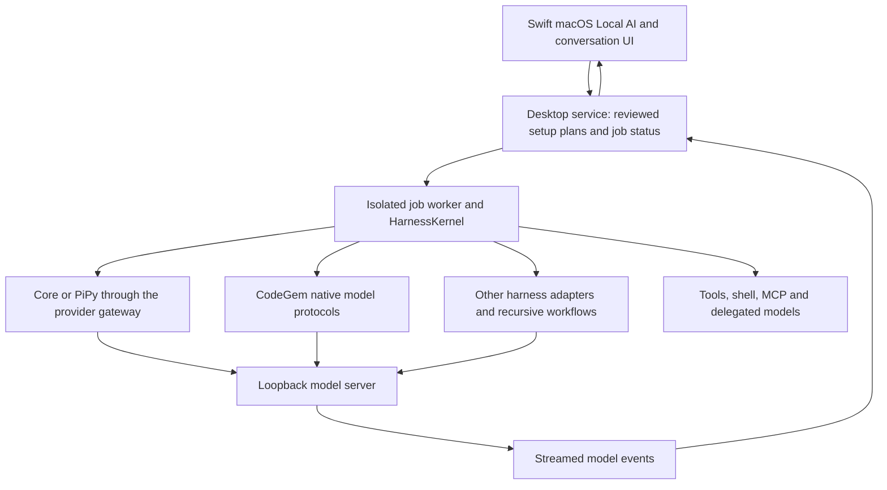

# Local AI on macOS: architecture and readiness audit

Reviewed 11 November 2026 against main `0b2834c7` and the response-latency fixes
in PR #52. Official upstream documentation and source were checked directly.
This is a source and protocol audit, with controlled transport and desktop
worker tests. It is not an Apple Silicon performance certification.

SuperQode has a useful local-first foundation. Its main opportunity is to make
**model, runtime and harness evaluation** easy to compare and reproduce. Adding
more model names does not establish better coding quality or faster inference.
The current app should not be described as supporting every Mac runtime through
one equally complete setup flow.

## Execution structure

The Swift app is a client of the shared Python engine. Using Swift does not
remove cold model loading, prompt prefill, reasoning, server queueing or tool
latency. The model server controls GPU kernels and most memory allocation.
SuperQode controls request size, context contracts, tools, routing, orchestration
and when response events reach the UI.

Relevant implementation boundaries:

| Responsibility | Source |
| --- | --- |
| Hardware and memory guidance | `local/hardware.py`, `guardrails.py`, `context_contract.py` |
| Cached weights and live inventory | `local/inventory.py`, `model_metadata.py` |
| Install, download, load and server plans | `local/install.py`, `servers.py`, `workbench.py` |
| macOS setup and model binding RPCs | `desktop_service/local_models.py`, `local_quickstart.py`, `local_harnesses.py` |
| Ordinary model requests | `providers/gateway/litellm_gateway.py`, `providers/local/` |
| Gemini/Gemma native requests | `codegem/provider.py`, `codegem/local_stream.py` |
| Endpoint probes and coding evaluation | `local/bench.py`, `coding_check.py`, `eval_runner.py`, `optimize.py` |
| Swift views | `LocalQuickStartView.swift`, `LocalModelsView.swift`, `LocalHarnessesView.swift` |

Python paths above are relative to `src/superqode`; Swift paths are relative to
`apps/macos/Sources/SuperQode`.

## Mac serving options and current coverage

These are different layers. Ollama, MLX and llama.cpp serve models; Jan and LM
Studio also provide model-management UIs. SuperQode should compose with them
and evaluate their coding behavior rather than reproduce their GPU engines.

| Solution | Upstream behavior checked | SuperQode status and limits |
| --- | --- | --- |
| [Ollama](https://docs.ollama.com/api/chat) | Native NDJSON streaming, model lifetime controls and model capabilities. [Loaded context](https://docs.ollama.com/context-length) and GPU residency matter. | Guided install, download, load, context/KV settings, readiness checks and model binding. Core/PiPy stream through the gateway; CodeGem now streams native Gemma. Ollama also offers cloud models, so an Ollama provider label alone is not proof of local execution. |
| [LM Studio](https://lmstudio.ai/docs/developer/openai-compat/chat-completions) | OpenAI-compatible streaming; [native model metadata](https://lmstudio.ai/docs/developer/rest/list) distinguishes loaded instances from model maxima. | Guided setup, load context, installed inventory and binding. Core/PiPy stream through the gateway; CodeGem now streams compatible Gemma. API authentication and older native API versions still need their own setup handling. |
| [MLX LM](https://github.com/ml-explore/mlx-lm) | Apple Silicon inference, streaming generation, quantization and prompt caching. Its [server source](https://github.com/ml-explore/mlx-lm/blob/main/mlx_lm/server.py) exposes compatible HTTP routes. | Isolated runtime install and reviewed model/server operations in advanced Local AI; newly visible on the first screen. Gateway MLX streaming is fixed in this PR. Guided newcomer downloads remain focused on Ollama and LM Studio. MLX files and GGUF files are different formats. |
| [llama.cpp](https://github.com/ggml-org/llama.cpp/blob/master/tools/server/README.md) | GGUF serving, Metal support, context/slots, KV-cache types, compatible streaming, template-dependent tools and prompt reuse. | Managed advanced operations and provider routing, now visible from the first screen. The server's loaded context and correct tool template remain necessary; a model-card maximum is insufficient. |
| [vLLM Metal](https://github.com/vllm-project/vllm-metal) | Apple Silicon plugin using MLX, paged scheduling and model-specific support. Official [memory-tier recipes](https://docs.vllm.ai/projects/vllm-metal/en/latest/recipes/) cover coding/tool parsers. | Existing `vllm` provider is a possible HTTP integration boundary. The Mac runtime workspace now has a named profile, reviewed Homebrew installation and tool checks. Model loading/server startup uses the official vendor recipe; exact artifacts/parsers still need real hardware evaluation. |
| [oMLX](https://github.com/jundot/omlx) | Compatible APIs, streaming usage, multi-model serving and memory/SSD prefix-cache tiers; tools depend on the model template. | A named compatible profile now handles its endpoint, session/Keychain key, reviewed Homebrew setup and supervised tool checks. Server/model lifecycle remains vendor-owned. SSD caching can help repeated prefixes but introduces disk and eviction tradeoffs; it is not a universal speedup. |
| [Jan](https://docs.jan.ai/desktop/api-server) | Configurable compatible local API, default `127.0.0.1:1337/v1`, optional API key. | A named profile template now accepts its explicit loopback URL and key without impersonating LM Studio. Vendor setup is manual; the shared adapter probes models and requires a tool check before coding. |
| [GPT4All](https://docs.gpt4all.io/gpt4all_api_server/home.html) | Opt-in localhost compatible server, default port 4891. | A named profile defaults to chat-only. Chat compatibility does not establish tool-capable coding compatibility. |
| [llamafile](https://github.com/mozilla-ai/llamafile) | Local distribution built on llama.cpp; current API behavior depends on its version. | The custom compatible profile can use its loopback endpoint. There is no dedicated managed lifecycle or certification; check its actual API and tool template. |
| [Apple Foundation Models](https://developer.apple.com/documentation/foundationmodels) | Framework includes on-device and server model access, availability checks, structured generation and tools. | The app now bundles an explicit native on-device text bridge with availability, streaming and cancellation, plus opt-in utility routing. No coding tools/images or cloud fallback. The older optional Python utility adapter remains supported; actual model quality/performance still needs evaluation. |

SGLang and other self-hosted provider routes also exist in the engine. They are
not automatically managed or verified Mac installations. Open WebUI and similar
clients can share a local server, but do not replace runtime/model validation.
Two clients competing for the same model also compete for its queue and memory.

## What the macOS app already exposes

The source includes installed-model reuse, curated Chinese/open-weight starter
suggestions, hardware/working-set estimates, context and KV controls, download
progress, vendor setup links, server ownership-aware Stop, warmup, local model
binding, generated-data readiness checks, harness compatibility and benchmark
workflows. Advanced setup covers five managed engine types. Search/readiness
results are distinguished from demonstrated coding quality.

The underlying engine also has local policy packs, model discovery, repository
sizing, local code indexing, optional local embeddings, endpoint benchmarks,
local coding evaluations, role recommendations and Airplane planning. Some are
reached through general workflow forms or the CLI rather than dedicated Mac
screens. Their existence in Python is not full native UX parity. The new runtime workspace brings shared queue/latency/memory observations, compatible profiles and explicit Apple availability into native controls; it links to the existing benchmark/evaluation workflows.

For Qwen, GLM, DeepSeek, MiniMax, Kimi and Gemma, validate the complete tuple:
model artifact and revision, quantization, runtime version, chat/tool parser,
loaded context, KV settings and harness. A Chinese-family model name is neither
a tool-support test nor a memory-fit guarantee. MoE models need space for total
resident weights, not only their active parameter count.

## Confirmed defects addressed

| Finding | Change and verification |
| --- | --- |
| Gateway MLX buffered an entire response before emitting apparent stream chunks. | Consume SSE incrementally. Real desktop Core/PiPy workers receive text before server generation finishes. Legacy JSON uses the original response; disconnects do not replay generation. |
| Local metadata probes could stack independent timeout delays. | Select the provider's endpoints and overlap independent probes, retaining loaded-window priority and fresh reads after reload. |
| Gemini CodeGem waited for HTTP EOF after a terminal response. | Finish/blocked events close the request; tool turns and normal long-decode continuation still work. Desktop job completion is verified with a deliberately lingering server. |
| Local Gemma CodeGem requested buffered responses. | Stream Ollama NDJSON and compatible SSE. Thinking/text display live; fragmented native arguments stay private until a valid terminal response. JSON tool envelopes stay buffered until parsed. Interrupted streams cannot expose executable calls or restart generation. |
| CodeGem ignored explicit output bounds on desktop local turns. | Forward task limits and bound Ollama `num_predict` and compatible `max_tokens`; preserve smaller harness limits. |
| Ollama `max` reasoning became disabled thinking in the locked LiteLLM mapper. | Normalize `max` to `high`; test through the real mapper for boolean-thinking and effort-based models. |
| The Mac checked five independent engines serially. | Concurrent readiness checks preserve display order and ownership rules. A synchronization-barrier test proves overlap without assuming a particular machine speed. |
| Local benchmark fragments were reported as tokens. | Use reported completion tokens; unavailable counts/rates remain unknown. Retain fragment counts as `output_chunks`, record `first_text_s`, and keep first-output TTFT distinct from visible text. |
| MLX/llama.cpp/DS4 were buried behind advanced setup. | Show their status and vendor guides on the first Local AI screen, linking to existing reviewed operations. Keep the newcomer download flow scoped to its supported engines. |
| Airplane smoke checked a constructed constant instead of the saved harness. | Inspect the prepared project's actual policy and primary/fallback routes. Missing/changed policies fail; the report identifies this as a static check, not measured egress isolation. |

Token throughput is a client-side estimate using server-reported token counts
and output timing. Chunk boundaries do not reveal how many tokens were in the
first fragment, and server-side prefill/decoding timers remain preferable for
engine benchmarking. `n/a` is more accurate than fabricating missing data.

## Remaining priorities

1. **Measured Mac matrix.** Exercise representative 16/24/32/64/128 GB Macs,
   cold and warm runs, exact artifacts/quantizations, context sizes and engine
   versions. Measure first output, first visible text, prefill/decode rates,
   peak memory, swap, cancellation and actual coding/test outcomes. Include
   negative tests for missing parsers and unsupported tools. No universal
   fastest-runtime or bug-free claim is justified by protocol tests.
2. **Unified native performance report.** Put measured timings, loaded context,
   output limits, residency and evaluation history beside the active model.
   Explain whether a wait is loading, prefill, thinking, queueing or tools.
   A native panel and shared local turn coordinator are now implemented.
   Server-only loading/prefill/decode data still varies by protocol, and GPU
   model attribution and production-model performance need further work.
3. **Extend tested runtime coverage.** Named and custom loopback profiles now
   provide per-profile credentials, declared context, supervised checks and
   coding/chat bindings. Expand real model/runtime evaluations, richer loaded
   context metadata and vendor lifecycle support. The original five-engine
   workbench still has fixed ports; named profiles are an explicit alternative.
4. **Expand guided setup only with evidence.** Bring installed MLX/GGUF reuse,
   memory-tier presets and supported parser selection into the same reviewed
   setup flow after the model/runtime pair passes readiness and coding tasks.
   Prefer appropriate small Qwen/Gemma artifacts on small Macs; do not
   auto-download large models because their family is popular.
5. **A complete offline profile.** Audit model endpoints, fallbacks, delegates,
   embeddings, MCP and shell/network tools together. A loopback primary model
   and an `allow_network: false` declaration do not prove OS-level isolation.
   Airplane configuration currently needs separate evaluation and a clear UX;
   it must not be marketed as an egress-tested Mac mode.
6. **Reproducible harness evaluation.** Compare the same held-out coding tasks
   across harnesses and runtimes in isolated workspaces. Store model revision,
   quantization, context, cache state, budget and independent outcome grades.
   Keep tool-shape smoke results separate from pass/fail of edits and tests.

## Validation boundary

Regression tests exercise real HTTP streaming and desktop job workers without
loading a production model. They cover first output before completion, native
argument assembly, JSON envelope buffering, incomplete output, cancellation,
legacy JSON, explicit budgets, context reload and truthful benchmark counts.
Existing local setup, inventory, install, evaluation and policy tests remain
part of the audit's verification.

The Linux workspace cannot measure Apple GPU throughput, verify Swift UI
rendering or prove every current quantization works. Native build/smoke and
hardware/model evaluation remain release checks. Two additional upstream pages
(LM Studio offline guidance and Jan model management) returned HTTP 403; those
pages were not used as positive evidence. All comparison claims above rely on
the linked accessible official documentation or project source.

The previous PR head `18a47040` passed desktop Python jobs on macOS and Linux,
but its native navigation smoke failed the UI-input responsiveness gate (up to
389 ms heartbeat delay). See the [native run](https://github.com/SuperagenticAI/superqode/actions/runs/43079371728).
This is a known validation failure, not a runner-capacity explanation. It needs
retesting and profiling before a performance release is declared ready. The
same CI run also exposed stale source-hash assertions and missing environment
documentation; these are corrected in this audit. Their cleanup does not prove
that the native responsiveness gate has passed.

## Implementation follow-up

The runtime/Apple follow-up is documented in [Local runtimes and Apple on-device
inference](local-runtime-workspace.md). It adds explicit profiles, reviewed
vLLM Metal/oMLX install plans, cancellable checks/warmup, shared generation slots,
prompt-free measurements and the bundled native Apple text bridge. The native
bridge also plugs into existing utility hooks, so the app does not require the
optional Python Apple SDK.

The native build and first app smoke for follow-up head `b7a19363` passed in
[CI](https://github.com/SuperagenticAI/superqode/actions/runs/43113624599), including
the unchanged navigation responsiveness gate. Apple bridge availability was
checked on the runner. Actual on-device generation is tested only if the system
model is available; protocol tests with a fixture helper do not replace that.
Subsequent revisions must keep those checks green. This source and protocol
work does not establish a universal inference-speed improvement.
