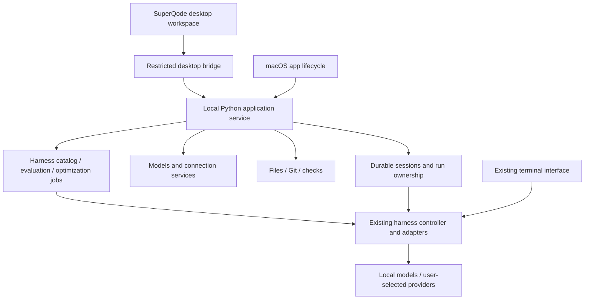

# SuperQode for macOS: product and delivery plan

Date: 19 October 2026. Status: native Swift implementation in progress; public release gates remain.

Implementation checkpoint: a runnable Apple Silicon desktop preview now lives in [apps/macos](../../apps/macos/README.md), with a bundled Python engine, native model/provider connection setup, optional Keychain credentials, coding workspace, shared Hub catalog, evaluation scorecards, staged optimization integration and local evidence. The broader release plan below remains the target; the preview does not yet cover every desktop workflow. [Release requirements](../../apps/macos/RELEASE.md) distinguish tested behavior from remaining distribution and product-validation work.

## Product decision

Build a local-first desktop coding workspace using SuperQode's existing Python execution engine. Its defining workflow is **choose a harness, code, measure, improve, and review adoption**. Make it easy to open a project, select a working model or agent, complete a task, approve actions and review changes. Preserve the standalone terminal product.

Harness Hub, Evaluations and Optimization are first-class destinations in the initial public desktop release. They are not optional marketing tiles or terminal shortcuts. The coding-only vertical slice is an internal engineering milestone, not the complete desktop product.

Release for Apple Silicon macOS first. Use native Swift presentation and a local service boundary so future clients can reuse the engine, without building remote networking, accounts or mobile apps now.

The desktop app must improve the workflow, not merely provide a window around the terminal. Keep a terminal view available for users who prefer it and for advanced capabilities while graphical coverage grows. Clearly distinguish this compatibility path from completed GUI support.

Success means a developer can install the application, complete a useful task, compare supported harness configurations on a declared evaluation, and inspect an optimization candidate without learning SuperQode's command hierarchy or installing a Python development environment. Positioning should describe these concrete capabilities; claims of superior quality require measured results.

## 1. SuperQode's own identity

Use the existing design system as the starting point: dark layered surfaces, violet focus/primary accents, restrained magenta, diamond branding, compact technical status and the bordered composer. Derive tokens from `src/superqode/design_system.py` and `app/theme_bridge.py`; do not create a competing palette.

The desktop identity should express four things:

- **Your machine and models are visible.** The selected execution host, model and readiness are always understandable.
- **Work is inspectable.** Tool actions, changed files and checks lead naturally into review.
- **You control execution.** Approvals, Stop, queued input and recovery states are easy to find.
- **Improvement has evidence.** Harness selection, evaluation results and candidate changes connect directly to the coding workspace.

Use a readable system font for navigation and prose, monospace for code, paths, command output and the optional terminal-density interface. Preserve a fully monospace preference. Provide light mode, system appearance, keyboard focus, sufficient contrast and reduced motion from the beginning.

Avoid continuous scanning animations as the primary progress signal. Use specific states such as “Reading 3 files,” “Running tests,” or “Waiting for approval.” Use text/icons as well as color.

### Proposed workspace

```text
┌──────────────────────────────────────────────────────────────────────┐
│ ◇ SuperQode       Project / Branch       Local · Model ready         │
├──────────────┬──────────────────────────────┬────────────────────────┤
│ Projects     │ Task title and current state│ Changes   Checks       │
│              │                              │                        │
│ Recent tasks │ Request / plan / results     │ Selected file diff     │
│ • Working    │ Compact tool activity        │ or inspection detail   │
│ • Needs you  │ Expand details when needed   │                        │
│ • Finished   │                              │ Review / stage actions │
│              ├──────────────────────────────┤                        │
│ Models       │ <> What shall we work on?    │                        │
│ Harness Hub  │ Harness · Model · Access     │                        │
│ Evaluations  │                              │                        │
│ Optimization │                              │                        │
├──────────────┴──────────────────────────────┴────────────────────────┤
│ Terminal / Output        1 running · 1 approval · 2 queued            │
└──────────────────────────────────────────────────────────────────────┘
```

This is a proposed information layout, not a final visual design. Review polished static designs for welcome, active coding, approval, diff review, Harness Hub, evaluation comparison and optimization inspection before implementing every screen.

At narrow window widths, show one primary content pane and collapse the inspector. Never shrink code or the composer until they become unreadable. Save pane state per project.

## 2. The first useful release

### Onboarding: open a project and become ready

Offer two clear paths: **Use an installed agent** and **Use a local model**. Keep API-key setup available as another connection option. Show only discovered and supported choices initially, with an explicit way to add others.

Reuse existing hardware detection, engine inventory, provider diagnostics and connection capabilities. Distinguish “installed,” “running,” “signed in,” “configured” and “ready to code”; they are not interchangeable.

For a local model, show required download size, estimated memory fit, engine and storage location before starting a download. Display a named recommendation with its rationale and limitations. Never download weights or install a vendor tool merely because the settings screen opened.

The app must remain usable when a dependency is missing. Give a clear action and progress/error state rather than a console traceback. Launch external sign-in on the user's Mac and verify successful authentication before reporting readiness.

### The coding workspace

Open an existing folder through the native picker and show recent projects. Create and resume tasks. Provide a composer with file context, multiline editing, paste handling, drafts, attachments only where supported, and a model/agent selector.

The central activity stream combines the request, plan, compact tool activity and final outcome. Raw logs expand on demand. Keep **Stop**, pending approvals and queued messages visible during execution. Follow-up input must explicitly show whether it will steer or queue; do not silently change its meaning.

Use an optional worktree for isolated tasks. Show its branch and path and provide a safe way back. Do not create worktrees invisibly for every trivial interaction.

### Review that leads to a decision

Make changed files and diffs first-class. Show which checks actually ran, their exit status and a bounded output preview. “No checks recorded” must never look like a pass.

First release: inspect a diff, open a file, run a configured check, stage/unstage and create a local commit. A guarded checkpoint restore can follow when filesystem and conversation semantics are established for the selected runtime. Push and pull-request creation are a later increment, with existing branch protections and explicit destination.

Keep approval of a tool invocation distinct from acceptance of a delivery candidate or a Git merge.

### A useful model screen

Create a **Models** screen containing installed models, running engines, readiness, storage and hardware fit. Start/stop managed engines; identify external engines without taking ownership of them. Offer guided downloads where supported, cancellation, progress and useful recovery.

Do not promise every model supports tools, images or reliable coding. Drive controls from backend capability metadata. Avoid duplicating model-selection logic in the frontend.

### Reliable Mac behavior

Support application menus, standard shortcuts, Finder folder opening, recent projects, clipboard, native file dialogs, window restoration and completion/action-required notifications after permission is granted.

Closing the last window leaves active work running while the application remains open. Quitting with active work presents the concrete consequence and offers to keep running or cancel and quit. The initial app does not silently install a login/background service. A crash/restart restores durable history and reports interrupted execution honestly.

### Harness Hub: discover, inspect and use

Make **Harness Hub** a persistent navigation destination. Reuse the existing complete catalog rather than maintaining a smaller desktop-only inventory. Show native harnesses, coding-agent connections, ACP agents, optional runtimes, task/model presets and project HarnessSpecs. Keep model servers, memory providers and other dependencies in their own screens.

Provide search and filters for Ready, Needs a model, Needs setup, Your harnesses and supported capability. Clearly distinguish ecosystem-watch entries that cannot run. A large catalog is useful only if readiness and support are honest.

Each entry opens a useful inspector: purpose, runtime and provenance; required model/credentials; supported tools and permissions; continuity limitations; configuration; and relevant recorded evaluations. Actions are **Use**, **Duplicate and configure**, **Evaluate**, and **Optimize**, enabled only where the backend can honor them. External-agent entries must not imply their internals are editable or optimizable.

The task composer shows both harness and model. Changing the harness explains whether the next turn continues, forks, or starts fresh. A task result links back to the exact harness revision used. A score on a harness card must identify the suite and model; there is no universal quality badge.

### Evaluations: compare with evidence

Make **Evaluations** a full screen with run history, suite selection, progress and results. The first release supports selecting an existing task suite, recording a baseline and comparing one supported candidate configuration. It also reads existing compatible local evaluation artifacts.

The result view shows per-task passes/failures, baseline-to-candidate regressions and improvements, duration, and recorded token/cost data. Unknown usage stays unknown. An expandable failure opens the task, check output and relevant evidence; a result is more useful than an unexplained aggregate score.

Record the repository revision, harness revision, provider/model, suite revision, execution mode, budget and relevant seed/repetition settings. Label fixture/dry-run results separately from live model runs. Flag mismatched comparison conditions instead of presenting them as a fair ranking. Distinguish readiness tests, task correctness, rubric scores and benchmark results.

Respect the existing non-regression gate. Show sample size and repeated-run variation when available, and distinguish optimizer-visible tasks from held-out validation. The UI must not encourage selecting an optimized candidate on its training score alone.

### Optimization: run a controlled improvement workflow

Make **Optimization** a full screen connected to completed evaluations. Present the actual optimization targets separately:

| Target | User question | Existing foundation | Initial desktop treatment |
| --- | --- | --- | --- |
| Local model route | Which configured route fits this role and machine? | `local optimize` | Results/readiness visible; guided execution as backend integration passes |
| Harness | Can this configuration improve on these tasks? | `harness optimize`, `harness optimize-omni` | One complete validated method required for public beta; other methods show precise availability |
| Skill | Can these reusable instructions handle recurring failures better? | `skills optimize`, SkillOpt checks | Existing artifact inspection first; guided execution in a following increment |
| One coding task | Can instruction refinement produce a better candidate patch? | `harness refine` / Harness2 | Discoverable from Hub and Optimization; opt-in guided workflow by a later increment, explicitly experimental |

The core GUI workflow is **select artifact and evaluation suite → record baseline → select a supported method → review budget and setup → run → inspect candidate changes and validation → adopt explicitly where supported**.

Before execution, show optional dependencies, which model performs optimization, which model executes tasks, estimated versus hard limits, output location and held-out requirements. Stop must cancel the job and retain inspectable evidence. Reopening a job must not silently rerun it.

During execution, show candidate attempts, current stage, budget consumed and failures. Afterward, compare the actual configuration/instruction diff alongside task outcomes and recorded cost/latency. Preserve the baseline and rejected attempts. Do not invent a single quality score that conceals regressions.

Adoption follows each method's actual contract. Staging-only methods remain staging-only; the GUI cannot bypass policy auditing or held-out gates. Where explicit adoption is supported, preview the exact files and preserve the previous version for a supported rollback. Clearly separate adopting a harness from applying a task patch or merging code.

### Connect the screens into one product

From a task, offer **Inspect harness** and **Evaluate this configuration**. From a failed evaluation, offer **Inspect failure** and **Prepare optimization** with the selected evidence attached. From an accepted, adopted configuration, offer **Start task with this revision**. None of these actions silently spends model budget or changes the live configuration.

Keep these destinations visible without forcing every user through them. A new user can simply code; an experienced user can run the full improvement workflow in the same app. Empty states explain what can be measured and provide an explicitly labelled sample or suite-setup path, never fabricated results.

## 3. Map existing features without overwhelming users

| Existing capability | Desktop presentation | Release |
| --- | --- | --- |
| Projects, sessions and history | Project navigation and resumable task list | First useful release |
| Streaming, tools, plan and TODOs | Activity stream with expandable details | First useful release |
| Local engines and model readiness | Models screen and guided setup | First useful release |
| Existing agent/BYOK connections | Connection setup and task model picker | First useful release for a declared supported set |
| Approvals and clarification | Inline request plus persistent “Needs you” indicator | First useful release |
| Queue, steering and cancellation | Explicit composer delivery mode and Stop | First useful release where runtime supports it |
| Files, search and diffs | Context picker, file viewer and Changes inspector | First useful release |
| Shell and staged output | Terminal/output drawer; stage an excerpt into composer | First useful release |
| Themes and keyboard workflow | Shared palette tokens, command palette and preferences | First useful release |
| Harness Hub | Complete catalog, readiness, inspection, selection and evaluation/optimization entry points | First useful release |
| Harness authoring | Form-assisted editor with validation and YAML preview | Later desktop increment |
| Children and supervision | Run tree with owner/model/status and results | Later desktop increment |
| WorkOrders and delivery | Dependencies, evidence, review and guarded execution | Later desktop increment |
| Evaluations | Suite selection, live baseline/candidate run, per-task scorecard and regression inspection | First public release |
| Harness optimization | Budgeted execution of one validated method, candidate diff, validation and method-specific adoption | First public release |
| Local-route and skill optimization | Method inventory, readiness and compatible saved-result inspection | First public release; additional guided execution follows |
| Harness2 refinement | Opt-in job setup, budget preview and candidate inspection | Later desktop increment; retain experimental label |
| Context/memory/RLM controls | Inspectors and advanced settings | Later desktop increment |
| MCP, extensions and skills | Connection/library settings with explicit trust/setup | Basic status first; management later |
| Export/import and diagnostics | Local export and redacted support bundle | Desktop beta |
| Remote devices and phone access | Future client of the same service | Deferred |

Create a parity register from `command_registry.py`, bindings and screens. Each feature must be labelled GUI-supported, terminal-supported, runtime-dependent or planned. Do not claim full GUI parity at the first release.

Advanced terminal functionality stays available in the existing CLI. An embedded terminal can launch it, but it is a separate session unless managed attachment has been implemented. Do not show two independent executions as if they were one task.

## 4. Implementation architecture

### Recommended stack

Use **SwiftUI + AppKit** for the complete native desktop application and **the existing Python engine** behind a private local application service. Bundle the engine inside the app. All windows, navigation, presentation, dialogs and macOS integration are implemented in Swift. There is no web renderer or remote-hosted product UI.

This is the selected product direction. Future browser/mobile presentation will require its own frontend using the engine boundary; presentation reuse is not a reason to compromise the native Mac experience.

Swift owns process lifetime, native file selection, local preferences, approvals and user-facing state. The original engine owns harness execution, model integrations, evaluations, optimization and authoritative tool policy. Rewriting the execution engine is a separate migration requiring a compatibility specification and parity tests.



The diagram is a target boundary. Existing TUI paths remain supported during incremental extraction; it is not a claim that every current action already passes through one service.

### Existing code to reuse

| Source | Role |
| --- | --- |
| `harness/protocol_controller.py`, `harness/protocol.py` | Lifecycle and capability contracts |
| `harness/events.py`, `harness/store.py` | Durable event and input storage |
| `pure_mode.py` and runtime adapters | Execution and streaming callbacks |
| `session/persistence.py`, `session/switchboard.py` | History, routing and continuity metadata |
| `local/hardware.py`, `local/inventory.py`, `local/servers.py` | Hardware, models and engine ownership |
| `providers/credentials.py` | Existing credential resolution |
| `workorders/` | Delivery, workers, checks and evidence |
| `harness/hub.py`, `harness/catalog.py` | Shared harness inventory and metadata |
| `harness/eval.py`, `harness/evaluators.py` | Evaluation execution and scorecards |
| `commands/harness/optimization.py`, `harness/optimize.py`, `harness/promotion.py` | Existing optimization entry points, artifacts and promotion rules to adapt into services |
| `skillopt.py`, `harness/refinement/` | Skill checks and experimental task refinement |
| `design_system.py`, `app/theme_bridge.py` | Shared visual tokens |
| `app/mixins/` | Existing behavior to extract selectively, not expose as widget RPC |

Introduce a dedicated application-service layer rather than making `server/api.py` or Textual widgets the permanent desktop contract. Reuse suitable functions; the existing session API is not a full interactive execution API.

Proposed new areas: `apps/macos/`, `src/superqode/desktop_service/`, and generated contract fixtures. Final directory names should follow the implementation review.

### Transport and ownership

Initial implementation: the Swift app starts one version-matched Python service with inherited stdin/stdout pipes. No loopback listener or authentication token is needed because the operating system supplies the private parent-child channel. Native dialogs select projects and imported artifacts. The service exposes a fixed command surface and validates project paths and approval tokens. Future remote clients require a separately designed authenticated transport; they are not enabled by this local protocol.

Use typed schemas for commands, events, errors and capabilities. Generate/check Swift contracts from the Python-owned schema or a neutral schema source; do not maintain two independent handwritten protocol definitions.

Minimum service groups: project/session selection; model readiness; task input/steering/cancel; approvals; event replay; files/diffs/checks; harness catalog and revision inspection; evaluation jobs and scorecards; optimization jobs and candidate inspection; settings. Responses include protocol version and supported capabilities. Paginate history and bound logs.

Evaluation and optimization jobs need durable IDs, lifecycle events, cancellation, resource limits and saved-artifact discovery independent of the screen displaying them. Reuse existing execution/validation functions behind typed services rather than scraping CLI text. Keep explicit provenance linking the originating task, harness revision, suite, baseline and candidate. Define CPU/GPU concurrency limits so an experiment does not silently starve an interactive coding task.

One host service owns each desktop-managed session. Persist accepted commands with idempotency keys before acknowledgement. Reconnect replays events, not arbitrary shell operations. Separate agent completion, validation and delivery states.

Keep draft/UI preferences separate from execution records. Start by adapting existing stores rather than creating another competing session database. Define explicit mappings if a desktop session points to an existing harness session.

## 5. Packaging is an early milestone

A clean Mac should not need Homebrew, Node, uv or a system Python installation to open the app and run its supported core.

Prototype a bundled CPython runtime and pinned wheel payload. Evaluate a frozen distribution only if dynamic imports, package resources and subprocess behavior pass. The current optional-dependency surface makes packaging a real engineering risk, not a final-day task. Python freezing tools have platform-specific behavior that must be validated. [Packaging reference](https://www.pyinstaller.org/en/stable/usage.html)

Keep the signed app bundle immutable. Store data and explicitly installed optional capabilities in documented user-owned locations. Avoid silently modifying the user's existing CLI installation or credential files. Detect existing setup and offer explicit reuse/import; do not overwrite it.

Ship a small declared runtime set first: the native engine, at least one supported local engine path, one supported existing-agent route, and one BYOK route. Install additional engines/SDKs only after user action. Model weights remain outside the app and updates.

Start with an Apple Silicon build; add Intel only when dependencies and testing support it. Select and publish the minimum macOS version after the packaging spike.

Distribute a Developer ID-signed, notarized application with tested installation and updates. Validate nested executable signing, entitlements, first-launch quarantine behavior, microphone permissions if enabled, and Finder-launched environment/PATH handling. [Apple distribution guidance](https://developer.apple.com/documentation/security/notarizing-macos-software-before-distribution)

Updates must respect active runs, migrate data safely and preserve a recoverable backup before schema changes. Do not promise downgrade compatibility after a data migration. Sign and verify update artifacts; do not implement an unsigned code-downloader as a shortcut.

## 6. Privacy and safety requirements

No mandatory SuperQode account or cloud history. Repositories, credentials, task records and model installations stay on the Mac by default. Calls to user-selected external models, tools, downloads and updates are separate, visible network uses.

The native application renders repository content and model output as inert text. No WebView, JavaScript runtime or HTML execution is used. Native file dialogs define explicit file-selection boundaries. Requests travel over inherited process pipes; the service does not bind a network port. Backend path checks and tool policy remain authoritative.

Provider keys never appear in frontend model lists, logs or diagnostics. Reuse supported credential stores and consider Keychain for new app-owned secrets. Make sharing support bundles an explicit action.

Approval decisions stay bound to the exact invocation and policy revision. UI permissions are not an OS sandbox; keep runtime filesystem/tool restrictions authoritative. An unavailable backend capability is visibly unavailable rather than silently approximated.

## 7. Delivery sequence

Estimates assume one Python/runtime engineer and one frontend/desktop engineer with part-time design and QA. They are planning ranges, not commitments. A solo implementation takes longer; re-estimate after the spike.

| Stage | Scope | Indicative effort | Exit gate |
| --- | --- | --- | --- |
| 0. Design and packaging proof | Workspace, Hub, evaluation and optimization designs; signed-app packaging experiment; start Python; exercise one streamed task; establish performance baseline | 1–2 weeks | Fresh Mac launches core without developer tools; differentiated workflow and design approved internally |
| 1. Complete coding slice | Project, readiness, one local/BYOK path, task stream, approval, Stop and diff inspection | 2–3 weeks | One task completed end-to-end in the GUI with correct policy and useful errors |
| 2. Daily-use alpha | Durable history, drafts, queue, supported agent connection, terminal/output, checks, local commit, model management, Harness Hub and Mac lifecycle | 3–4 weeks | Daily coding pilot plus complete catalog selection/inspection; no silent lost work |
| 3. Measurement and improvement | Live baseline/candidate evaluation, saved-result inspection, one complete budgeted harness optimization method and method-specific review/adoption | 2–4 weeks | Choose harness → code → evaluate → inspect optimized candidate works without terminal commands |
| 4. Public desktop beta | Installer/update hardening, accessibility, performance, diagnostic recovery, theme polish and documentation | 2–3 weeks | Core and measurement/improvement release gates pass on clean machines and real projects |
| 5. Expanded desktop tools | Additional optimization methods, skill/local-route execution, WorkOrders, advanced authoring, children, context and refinement | Separate prioritized increments | Each feature has a complete user workflow and backend tests |

A credible daily-use coding alpha is roughly **6–9 weeks** under those staffing assumptions. Including the required measurement and improvement workflows moves public beta to roughly **10–16 weeks**. The earlier 8–12-week estimate excluded this work from launch and no longer describes the agreed scope. Re-estimate after packaging, evaluation-job and optimizer integration spikes.

If capacity is one engineer, build project → one local model → task → approval → diff as an internal milestone, then complete Hub → evaluation → one optimization path before calling it the public desktop beta. Limit supported execution methods rather than hiding these product destinations. Do not start native mobile work or a relay in parallel.

### Suggested implementation changes, in order

1. Desktop shell, isolated state directory, backend launch/handshake and clean shutdown.
2. Typed service contracts and one task execution path.
3. Original workspace design and shared theme-token export.
4. Setup/readiness and local model selection.
5. Task stream, permission requests, questions, steering/queue and cancellation.
6. Changes/checks view and safe Git operations.
7. Durable history, reconnect, app lifecycle and recovery.
8. Model management, optional capability installation and diagnostics.
9. Full Harness Hub inventory, inspection, revision identity and launch actions.
10. Evaluation job service, suite selection, scorecards and regression comparison.
11. Optimization job service, budget preview, candidate diff, validation and method-specific adoption.
12. Signing/notarization, updates, accessibility and performance gates.
13. Additional optimization methods and advanced tools selected from observed user demand.

## 8. Acceptance criteria

Test functionality on a disposable repository and separately test delivery on a clean macOS account/machine.

- Install and open from Finder without a developer toolchain.
- Open a project, configure a supported route, complete a coding task and inspect the changed files.
- Run the same controlled task through CLI and GUI: model selection, workspace, permission decisions and artifacts agree where the runtime supports parity.
- Denied actions remain denied; stale approval buttons cannot authorize changed requests.
- Close/reopen the window during a run without losing execution; quit/cancel behavior is explicit.
- Service failure shows interrupted state, retains history and never automatically duplicates destructive effects.
- Model downloads, authentication failure, full disk, missing executable and unavailable engine have actionable recovery.
- Large transcripts and tool output remain bounded and scrollable.
- Keyboard-only use, VoiceOver labels, focus restoration, light/dark appearance and reduced motion work.
- Existing terminal regression tests remain green.
- Provider credentials are absent from desktop messages and diagnostic exports.
- Update installation and migration preserve user data and handle active work.
- The desktop Hub reflects the shared catalog, labels unsupported entries honestly and preserves selected harness/model identity in task records.
- A user runs a baseline and candidate against the same suite, opens a failed case and understands the non-regression gate without using the terminal.
- One supported optimization method completes from budget preview through saved candidate inspection and its allowed adoption flow; staging-only methods remain staging-only.
- Cancel/restart preserves experiment evidence without rerunning model calls; missing optional dependencies have explicit setup paths.
- Fixture results, live results, optimizer-visible tasks, held-out checks and unrecorded usage are clearly distinguished.

Provisional performance budgets, to validate rather than advertise as measurements: first interactive window within 3 seconds on the reference Apple Silicon machine; warm task switching within 200 ms; visible acknowledgement of local controls within 100 ms. Measure idle app/service memory separately from model inference. Set a memory budget from the packaging spike, including process counts and idle energy use.

For product validation, aim for at least four of five new pilot users to reach a useful diff without live help. Record where they get blocked, whether they understand the execution location and permissions, and whether they return to use the app. These are proposed release targets, not current results.

Also test experienced pilot users on a complete improvement workflow: choose a harness, run a comparison, identify a regression, inspect a candidate diff and explain whether it is safe to adopt. Discoverability of these capabilities is a release criterion, not just a marketing objective.

## 9. Scope boundaries and decisions

Commit now to an owned SuperQode identity, desktop-first release, existing Python engine, preserved terminal product, a reusable local service boundary, and first-class Harness Hub, Evaluations and Optimization workflows in the public beta.

Defer remote pairing, managed networking, native phone applications, cloud accounts, collaboration and a complete graphical mapping of every advanced command.

The first approved milestone should produce reviewable screen designs and a runnable packaged vertical slice. The next investment depends on evidence that the app makes ordinary coding tasks easier, while retaining the capabilities that make SuperQode useful.
